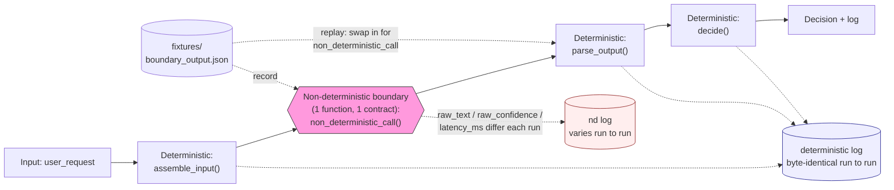

# Determinism tại ranh giới bất định

Hãy cô lập một lời gọi vốn dĩ bất định (một LLM, một output được lấy mẫu,
một API có độ trễ dao động) sau đúng một hàm với contract input/output cố
định. Giữ cho mọi thứ ở hai phía của nó — lắp ráp input, parse output,
quyết định phải làm gì — là code thuần, không có yếu tố ngẫu nhiên ẩn nào
của riêng chúng.

## "Deterministic quanh ranh giới" nghĩa là gì

Không phải là quyết định cuối cùng luôn giống nhau — nội dung ngữ nghĩa
tại ranh giới hoàn toàn có thể khác nhau giữa các lần chạy, và một tầng
quyết định đúng đắn sẽ khác theo. Thứ phải cố định là quy trình: với cùng
một output từ ranh giới, code bao quanh luôn làm đúng một việc như nhau.
Đã chứng minh trực tiếp: log deterministic (lắp ráp input, nhãn đã parse,
quyết định) trở về giống nhau từng byte qua nhiều lần chạy lặp lại, trong
khi output của chính ranh giới (câu chữ, confidence, độ trễ) thay đổi mỗi lần.

## Rò rỉ không chỉ thêm nhiễu, nó lật ngược quyết định

Tính bất định lọt qua ranh giới trong những đoạn code thoạt nhìn có vẻ
deterministic: một parser bám vào cách diễn đạt ngẫu nhiên thay vì nội dung
ngữ nghĩa, một timestamp lấy từ đồng hồ hệ thống nằm trong thứ trông như
logic quyết định thuần túy, hay việc duyệt theo thứ tự hash chỉ xáo trộn
giữa các lần khởi động tiến trình khác nhau. Bằng chứng mạnh nhất: một
parser ngây thơ bám vào câu chữ đã lật ngược một quyết định access-control
thật (cho phép hay từ chối) với cùng một input và cùng một phán quyết nền,
chỉ vì model tình cờ mở đầu bằng một từ khác. Không có gì crash hay báo lỗi
— hệ thống lặng lẽ làm sai trong khi log vẫn trông khỏe mạnh.

## Record/replay gần như miễn phí

Một khi ranh giới đã là một tham số hàm thực thụ thay vì một lời gọi
hardcode, việc ghi lại output của nó một lần vào fixture rồi phát lại qua
pipeline sẽ khiến toàn bộ log — kể cả nửa vốn hay thay đổi — giống nhau
từng byte qua các lần chạy.

## Điều này chưa chứng minh được gì

Đây là một khẳng định về cấu trúc, không phải về giảm phương sai — giảm
mức dao động của chính ranh giới (temperature, seeding) là một kỹ thuật
riêng, bổ trợ. Bản chứng minh cũng cố ý chạy offline: nó không hề đụng tới
phương sai lấy mẫu thật qua một lời gọi mạng thật, và "cùng một nhãn sống
sót qua các cách diễn đạt khác nhau" là tính chất của một stub được dựng
có chủ đích, không phải tính chất đo được của một model thật nào.

Bằng chứng: `experiments/agent-infra/determinism/` (`RUN.md`, `NOTES.md`, `diagram.mmd` / `diagram.png`).
