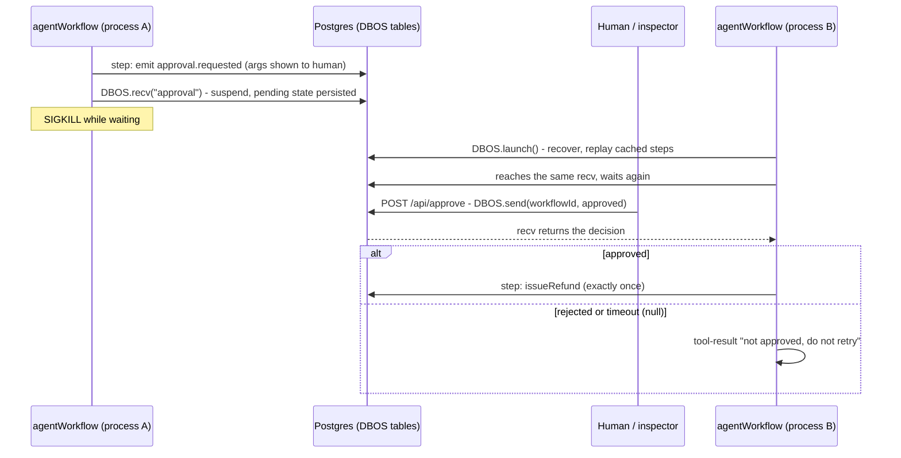

# Guardrails: Checks the Harness Enforces

Guardrails validate an intended action before it executes. The lesson from
building them is about *where* they live: a rule in the prompt is a request
to the model; a check in the harness's tool loop is a control. Only the
second one held up.

## Least privilege is checked at execution, against who decided

Hiding a tool's schema from an agent is hiding a button in a UI; the
executor must check permission itself. And it must check against the agent
that *produced* the turn, not the agent current when the call runs. One
turn from an unprivileged agent containing "hand off to billing, then
refund" executed the refund with billing's privileges when checked against
the current agent, and was denied when checked against the acting agent.

## Human approval is workflow state, not an awaited function

For irreversible actions the loop stops before the tool runs, shows a
person the exact arguments, and suspends durably until a decision arrives.
The process was killed while waiting; after restart it replayed to the same
wait and waited again, and the refund then ran exactly once on approve and
never on reject. Order inside the loop: permission, then handoff, then
needs-approval, then ordinary tools. A timeout counts as a rejection;
silence is never consent. An approval card without the arguments defeats
the gate.

## The decision has to be bound to the action

Approval messages queue until received and carried no call id, so a
double-click on the first approval silently pre-approved the second, which
then passed in milliseconds with nobody looking. The decision must name the
specific call it approves, and the endpoint that accepts it needs
authentication. Both are open in this experiment.

## What this doesn't prove

No output-content filters, no input validation beyond schemas, no fix for
the approval-binding hole or the missing auth. Sandbox escape is covered in
`tool-calling.md`.

Evidence: `experiments/agent-infra/harness/` (`RUN.md` §5, §7, `NOTES.md` "Orchestration" and "Human-in-the-loop", `logs/05_permission_escalation.log`, `logs/07_*.log`, `proofs/`, `diagram-approval.mmd` / `diagram-approval.png`).
