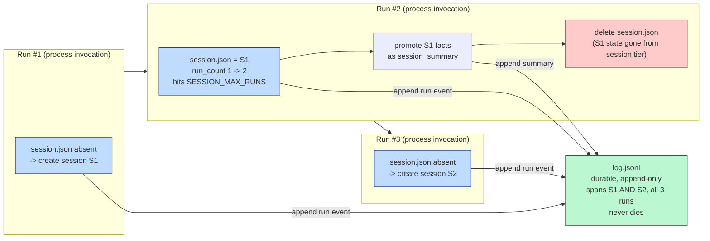

# Memory (phân tầng xuyên nhiều lần chạy)

`state.md` có phạm vi một lần chạy; file này ở cấp cao hơn một bậc — một
session (nhiều lần gọi cùng chia sẻ state) — với một tầng durable bên dưới
trải dài qua mọi session từng tồn tại. Working state chết khi lần chạy kết
thúc; session state sống sót qua nhiều lần chạy nhưng vẫn có tuổi thọ hữu hạn.

## Cùng một pattern, cao hơn một bậc

Một file session ephemeral bị ghi đè qua các lần chạy; một log durable
append-only tích lũy hoạt động của mọi session mãi mãi. Cả hai đều chỉ là
file thường — khác biệt nằm ở chính sách, không phải cơ chế: session state
bị xóa thẳng khi hết hạn, còn log thì không bao giờ bị xóa, chỉ được ghi thêm.

## Thứ tự promotion mới là phần chịu lực

Khi một session hết hạn, các dữ kiện của nó phải được ghi thêm vào log
durable — và lần ghi đó phải được xác nhận — *trước khi* file session bị
xóa. Đảo ngược thứ tự, hoặc không sắp xếp thứ tự rõ ràng, thì một cú crash
xen giữa hai thao tác sẽ tái hiện đúng kiểu mất mát crash-rồi-xóa-sạch của
`state.md`, chỉ ở tầng cao hơn. Bản thân việc hết hạn không phải thứ làm
điều này an toàn; promotion-trước-khi-xóa mới là.

## Một giới hạn cố ý: hết hạn nghĩa là "làm lại từ đầu", không phải "đi tiếp"

Khi một session hết hạn, lần chạy kế tiếp bắt đầu một session hoàn toàn
mới, không mang theo dữ kiện nào, dù bản tóm tắt của session tiền nhiệm vẫn
nằm trong log durable. Muốn có tính liên tục thì phải chủ ý đọc lại bản tóm
tắt đó lúc bootstrap; bản chứng minh này chưa làm điều đó.

## Điều này chưa chứng minh được gì

Nhiều lần chạy đồng thời tranh chấp cùng một file session, và việc đọc
ngược dữ kiện từ một bản tóm tắt cũ để khởi tạo session mới, đều chưa được kiểm chứng.

Bằng chứng: `experiments/agent-infra/memory/` (`RUN.md`, `NOTES.md`, `diagram.mmd` / `diagram.png`).
