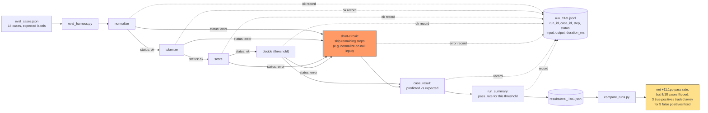

# Observability: trace nằm dưới con số

Một bài eval rút gọn cả lần chạy về một con số — hữu ích để biết "có tốt
lên không", nhưng không nói được vì sao. Observability là cái trace có cấu
trúc, theo từng bước, theo từng case, nằm dưới con số đó; thiếu nó thì một
regression có thể được phát hiện nhưng không thể debug. File này phụ trách
nửa tracing/instrumentation; còn phương pháp luận eval nằm ở `concepts/eval.md`.

## Cùng một điểm số có thể che giấu hai hệ thống khác nhau

Một harness có cấu trúc (mỗi bước pipeline của mỗi case một bản ghi JSONL)
và một phiên bản ngây thơ bọc trong đúng một `try/except: print("case
failed")` đều cho 12/18 y hệt nhau trên cùng 18 case. Chỉ log có cấu trúc
mới phân biệt được một cú crash với một câu trả lời sai: trường `status`
(`ok` / `error`) cộng với `step` và `step_seq` cho phép một lệnh `grep`
chỉ ra rằng case hỏng đã vỡ ở `normalize`, tại bước 1 trên 5, trước khi
`tokenize`, `score` hay `decide` kịp chạy. Phiên bản ngây thơ mãi mãi chỉ
nói được "case failed". Một con số pass-rate trần trụi không phải là
observability — nó là bản tóm tắt mà observability làm cho khả thi.

## Một con số tổng có thể che giấu một sự đánh đổi

Nâng ngưỡng phân loại đã đẩy pass rate từ 66,7% lên 77,8% — một mức +11,1
điểm thật và tái lập được. Báo cáo riêng lẻ, nó đọc như một thắng lợi
sạch sẽ. Thực ra không phải: 8 trong 18 case bị lật kết quả, và phần tăng
ấy là 5 false positive được sửa, đổi lấy 3 true positive mới hỏng. Con số
tổng và bản diff theo từng case trả lời hai câu hỏi khác nhau — "cái này
có giúp ích không" và "nó tốn cái gì" — và chỉ câu thứ hai mới cho thấy sự
đánh đổi thực sự đang diễn ra.

## Bản ghi cần mang theo những gì

`run_id` và `case_id` để nối mọi bản ghi về đúng một lần gọi và đúng một
case, `step`/`step_seq` để định vị chuyện xảy ra ở đâu trong pipeline,
`status` (đừng bao giờ gộp thành một cặp pass/fail duy nhất) để tách một
câu trả lời sai khỏi một cú crash, và `duration_ms` để loại trừ khả năng
treo. Chỉ những trường mà bài eval thực sự chấm điểm mới cần deterministic
— một `run_id` mới tinh ở mỗi lần chạy là hoàn toàn ổn.

## Điều này chưa chứng minh được gì

Hệ thống được kiểm thử không có chút ngẫu nhiên nào trong logic quyết
định, nên pass rate tái lập được là chuyện đương nhiên qua các lần chạy
lại. Một hệ thống có LLM trong vòng lặp sẽ không được như thế miễn phí —
nó cần seeding tường minh hoặc replay tại ranh giới bất định
(`concepts/agent-infra/determinism.md`).

Bằng chứng: `experiments/agent-infra/observability/` (`RUN.md`, `NOTES.md`,
`diagram.mmd` / `diagram.png`). Nửa eval-harness cung cấp đầu vào cho
`playbooks/build-eval-set.md`.
