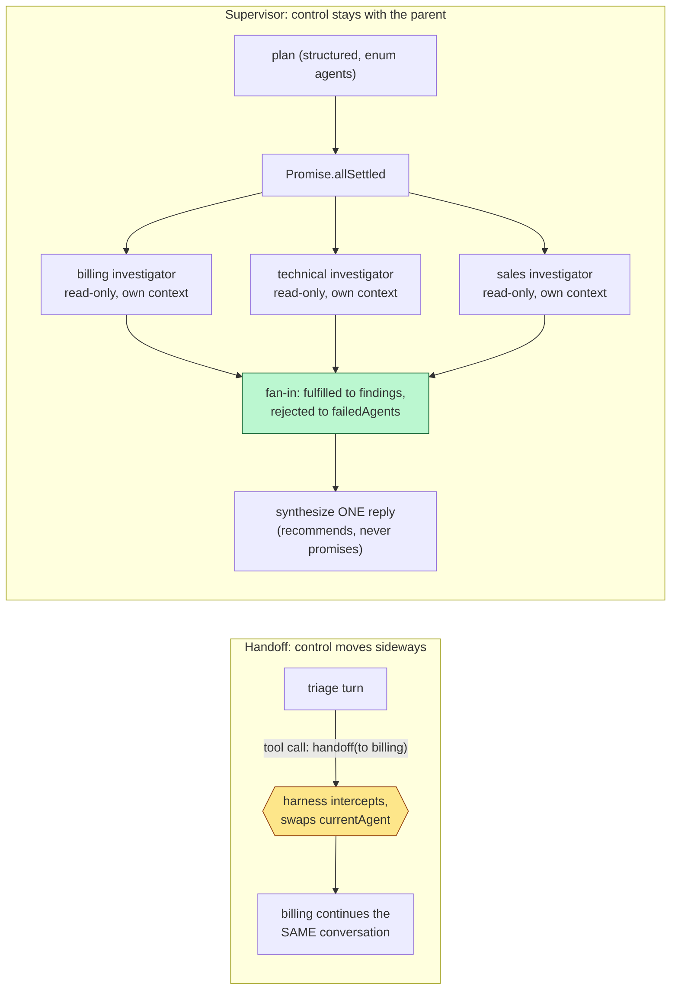

# Orchestration: Handoff vs Supervisor

Orchestration is how work is divided between agents. The two shapes worth
keeping apart are defined by one question: **who holds control after the
split?**

## Handoff: control moves sideways

The current agent calls a pseudo-tool, the harness intercepts it and swaps
which agent runs the next turn. Nothing is returned to the first agent; the
same conversation simply continues under a different system prompt and tool
set. Agents are data (prompt, tools, allowed handoffs), and the harness is
the only thing that changes who is in charge. Use it when the work belongs
to one specialist from here on.

## Supervisor: control stays with the parent

The parent produces a structured plan, calls sub-agents like functions in
parallel, each with its own context and read-only tools, collects every
outcome, and writes one answer. Collecting with "all settled" rather than
"all succeed" makes a failed sub-agent data instead of a crash: with one
investigator forced to fail, the run still completed and the failure was
recorded and acknowledged. Use it when one request has several independent
parts.

## Synthesis turns recommendations into promises

A read-only supervisor still told the customer "we'll refund the duplicate
charge", although nothing had been done and nothing could be. The prompt
controls what is *said*; only the harness controls what is *done*. Telling
the synthesizer explicitly that no actions were taken, and passing it the
list of failed sub-agents instead of letting it infer them, changed the
reply to "recommended, pending review". The same request through a single
handoff loop instead acted directly, because that loop holds the write tool.

## One contract, one type

The plan schema allowed three sub-agents while the registry implemented
one; a loose map type let it compile, and the gap only showed as two
failures at runtime. The plan's allowed values and the registry should come
from one type.

## What this doesn't prove

A handful of live runs, one support domain. No cost or latency comparison
between the two shapes, no nested supervisors, no sub-agent with write
access.

Evidence: `experiments/agent-infra/harness/` (`RUN.md` §5–§6, `NOTES.md` "Orchestration", `logs/06_supervisor_chaos.log`, `diagram-orchestration.mmd` / `diagram-orchestration.png`).
