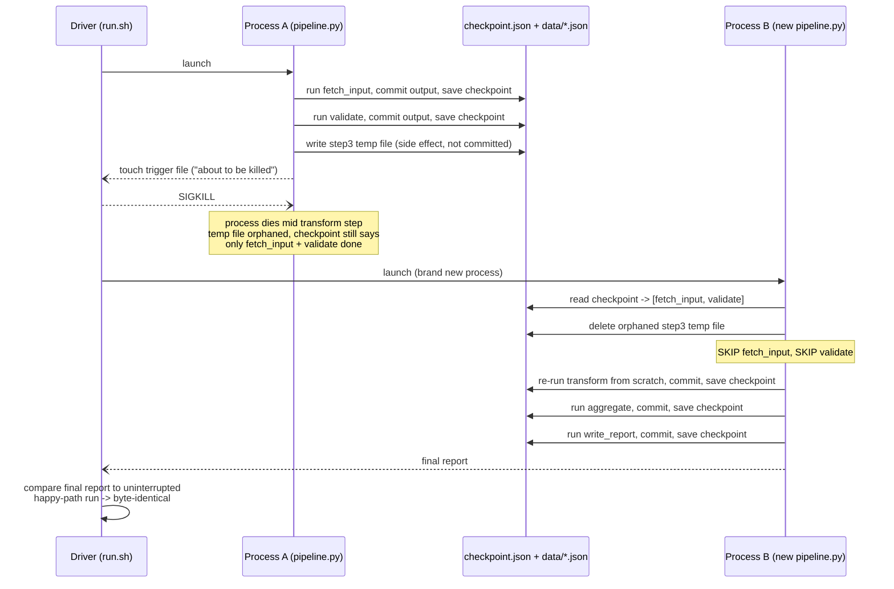

# Recovery: checkpoint và resume xuyên qua một lần khởi động lại

Một tiến trình nhiều bước mà phải chạy lại từ đầu sau bất kỳ cú crash giữa
chừng nào thì đã hỏng ngay từ thiết kế, bất kể nó chạy tốt đến đâu trên
happy path. Bằng chứng: một lệnh `SIGKILL` thật rơi vào giữa một bước trong
pipeline 5 bước, rồi một tiến trình hoàn toàn mới — không chia sẻ bộ nhớ gì
với tiến trình đã bị giết — tiếp tục và hoàn thành nó.

## Checkpoint không bao giờ được phép nói dối

Checkpoint của một bước chỉ được ghi sau khi output của bước đó đã commit
một cách atomic (file tạm, fsync, rename vào đúng chỗ). Thứ tự đó bảo đảm
checkpoint và artifact mà nó mô tả không bao giờ mâu thuẫn nhau. Một
`SIGKILL` giữa bước sẽ rơi vào file tạm, không bao giờ rơi vào đường dẫn đã
commit — nên cú crash chỉ để lại một file tạm mồ côi và không gì khác, và
bước đó có thể làm lại từ đầu an toàn, vì nó là một hàm thuần của input đã
được commit trước đó.

## Phép so sánh bằng nhau mới là bằng chứng thật

Khởi động lại sau cú giết đã bỏ qua hai bước mà checkpoint đã xác nhận, làm
lại từ đầu bước bị gián đoạn, rồi hoàn tất phần còn lại — cho ra một artifact
cuối cùng giống hệt từng byte so với một lần chạy không hề bị gián đoạn. Với
các bước thuần và deterministic, chạy tiếp sau gián đoạn là không thể phân
biệt với chạy liền một mạch.

## Hai cơ chế, không phải một — cả hai đều phải đúng

Checkpointing và atomic write là hai bảo đảm riêng biệt. Cùng kiểu giết đó
nhắm vào một bước ghi thẳng output thật của nó (không file tạm, không
rename) sẽ khiến file đó hỏng vĩnh viễn, và không logic checkpoint nào cứu
được — vì không hề tồn tại khái niệm "file đã commit này thực ra là rác".
Chính tính atomic mới làm cho một checkpoint đáng tin ngay từ đầu.

## Cái giá của việc bỏ qua chuyện này không hề nhỏ mãi

Cũng cú crash ấy giáng vào một pipeline không có khái niệm checkpoint sẽ
khởi động lại mọi bước từ bước 1, kể cả phần việc đã xong — chỉ là sai số
làm tròn với năm bước rẻ tiền, nhưng nó tổng quát hóa rất tệ một khi có một
bước chậm hoặc có side effect thật (một lời gọi API, một lần bị tính tiền)
mà checkpoint lẽ ra đã ngăn không cho kích hoạt hai lần. Chuyện này khác với
retry/fallback/loop-guard quanh một lời gọi đơn lẻ — đó là khả năng chống
chịu theo thời gian thực bên trong một bước, không phải khả năng resume
xuyên qua một lần khởi động lại — và chưa experiment nào ở đây phủ điều đó.

## Điều này chưa chứng minh được gì

Thực thi các bước đồng thời hoặc song song, checkpoint ở giữa chừng một
bước đắt đỏ, recovery cho các side effect không idempotent (một khoản thanh
toán, một email đã gửi — những thứ này cần cơ chế khác, ví dụ dedup key), và
một cú crash rơi đúng lúc chính file checkpoint đang được ghi atomic — tất cả
đều chưa được kiểm chứng ở đây.

Bằng chứng: `experiments/agent-infra/recovery/` (`RUN.md`, `NOTES.md`, `diagram.mmd` / `diagram.png`).
