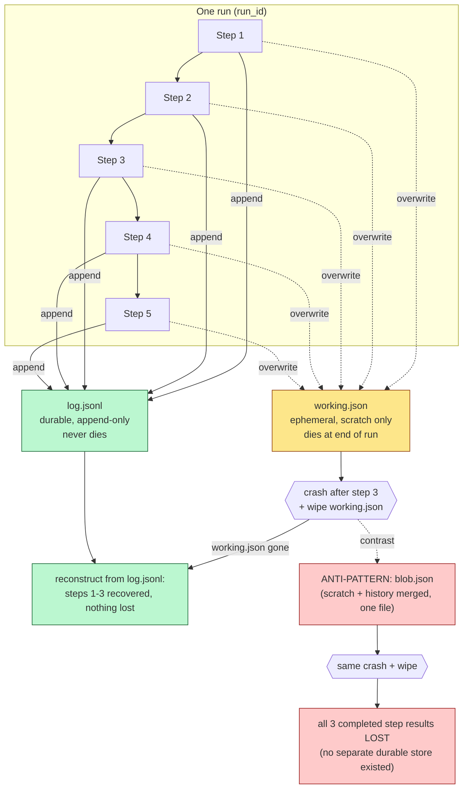

# Working State (một lần chạy)

"Working state" là những gì một lần chạy cần để đi từ bước đầu tiên tới
bước cuối cùng: giá trị tạm, buffer đang dở, bất cứ thứ gì một bước đang
tính ngay lúc đó. Nó chết khi lần chạy kết thúc — một cú crash, một lần
container bị recycle, hay việc xóa file đó đều không được phá hỏng thứ gì
vốn đã có giá trị.

## Hai tầng, không bao giờ gộp

Giữ phần scratch ephemeral (bị ghi đè ở mỗi bước) tách bạch tuyệt đối với
một log durable, append-only (mỗi bước hoàn tất một dòng, không bao giờ
ghi lại). Sự tách bạch này tốn thêm một lần ghi cho mỗi bước, nhưng chính
nó cho phép xóa sạch tầng ephemeral sau một cú crash và dựng lại tiến độ
thật của lần chạy chỉ từ log, mà không mất gì.

## Anti-pattern gộp-một-khối mới là thất bại thực tế

Gộp scratch và lịch sử vào một file bị ghi đè trông có vẻ *hay hơn* thiết
kế hai tầng khi lần chạy đang khỏe mạnh — lịch sử nằm ngay đó. Thất bại
vô hình cho tới khi một cú crash đi kèm với việc file đó bị xóa: kết quả
của mọi bước đã hoàn tất biến mất cùng với scratch, vì chưa từng tồn tại
một kho durable riêng. Tách tầng không phải là một tính năng; nó là bảo
hiểm trước một thất bại không có triệu chứng nào cho tới khi đã quá muộn.

## Điều này chưa chứng minh được gì

Nó cho thấy dữ liệu cần để resume vẫn sống sót qua một lần xóa working
state — chứ không phải một tiến trình tự động chạy tiếp từ điểm khôi phục.
Xem `concepts/agent-infra/recovery.md`.

Bằng chứng: `experiments/agent-infra/state/` (`RUN.md`, `NOTES.md`, `diagram.mmd` / `diagram.png`).
