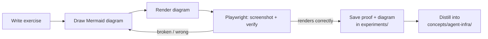
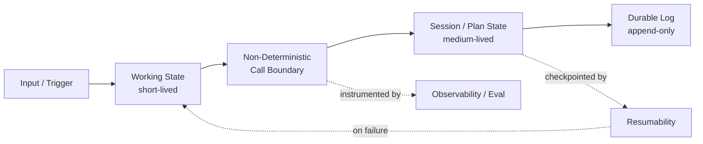
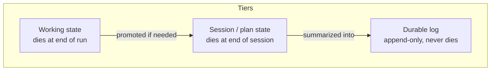
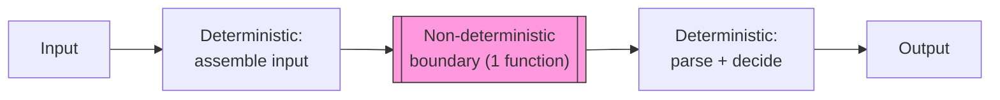
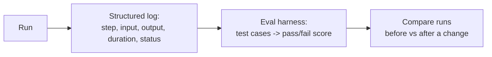
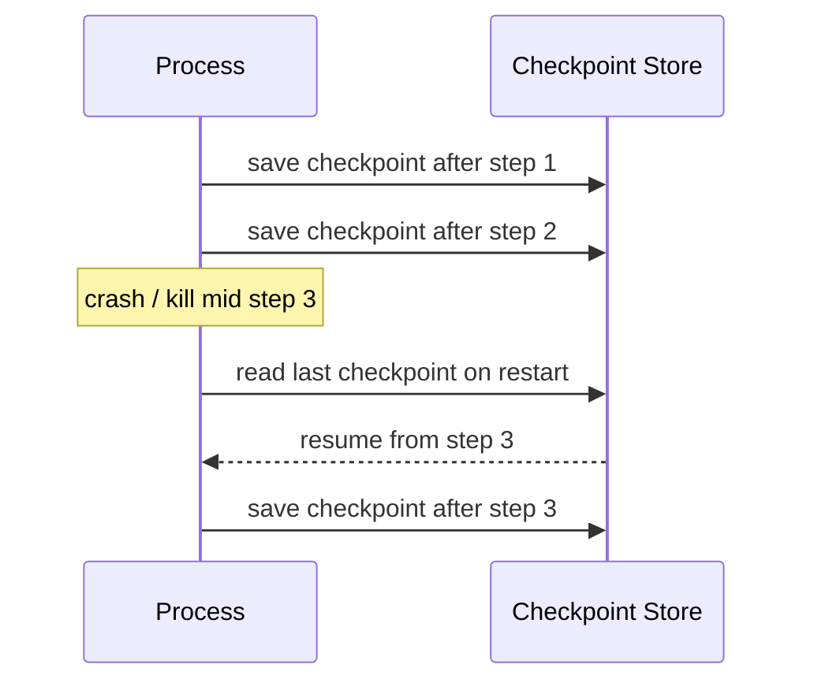

# PLAN.md — Kế hoạch thực hành nền tảng hạ tầng

## 1. Mục tiêu

Dựng bằng chứng thực hành, chạy được, cho từng pattern hạ tầng trong 4 pattern bên dưới. Tiêu chí "xong" cho mỗi cái không phải "tôi hiểu ý tưởng" — mà là "tôi có một mẩu code nhỏ chạy được, và nó sẽ hỏng một cách rõ ràng nếu tôi gỡ pattern đó ra".

## 2. Phạm vi

Giữ các bài tập nhỏ và không phụ thuộc hệ thống cụ thể. Mỗi bài nên làm được trong một script hay một module nhỏ — không cần cả một ứng dụng hoàn chỉnh. Mục đích là thấm pattern, không phải xuất xưởng sản phẩm.

## 3. Phương pháp làm việc cho mọi chủ đề

Với từng chủ đề trong 4 chủ đề bên dưới, vòng lặp xây dựng là như nhau:

1. Viết bài tập thực hành (script / module nhỏ). Lưu nó, log của nó, và mọi bằng chứng chạy vào thư mục `experiments/` của chủ đề (xem đường dẫn đích theo từng chủ đề bên dưới).
2. Vẽ một diagram Mermaid minh họa khái niệm — đây là cách kiến thức được mã hóa lại để tra cứu về sau, không phải để trang trí.
3. Render diagram và xác minh bằng Playwright: mở bản xem trước đã render (Mermaid Live Editor, một file HTML cục bộ có mermaid.js, hoặc bản export của Obsidian) trong trình duyệt headless, chụp màn hình, và xác nhận bằng mắt rằng nó render không lỗi cú pháp và đúng ý bạn định vẽ. Lưu mã nguồn diagram + ảnh chụp đã xác minh vào cùng thư mục `experiments/`.
4. Chỉ khi 1–3 đã tồn tại, mới chưng cất một đoạn framing ngắn vào file đích trong `concepts/agent-infra/` của chủ đề — theo đúng phong cách stub hiện có (ngắn, không code, không số liệu hay thay đổi). File concept phải đọc như phần kết luận; thư mục experiment là bằng chứng đứng sau nó.

## 4. Tổng quan 4 chủ đề

---

## 5. Phân tầng State & Memory

**Khái niệm**: thông tin có tuổi thọ khác nhau. Coi mọi thứ như một khối đồng nhất không phân biệt ("cứ quăng vào bộ nhớ / một file là xong") là sai lầm mặc định.

**Bài tập thực hành**:
- Thiết kế một hệ thống với ít nhất 3 tầng tường minh, mỗi tầng có tuổi thọ được nêu rõ (như trên).
- Lưu mỗi tầng riêng biệt (ví dụ `working.json`, `session.json`, `log.jsonl`) — tuyệt đối không gộp chúng vào một file.
- Viết một script nhỏ chứng minh ranh giới đó: working state có thể bị xóa sạch an toàn mà không mất gì từ log durable.

**Đường dẫn đích**:
- Bằng chứng / code / ảnh chụp diagram → `experiments/agent-infra/state/` (phần "working state" một lần chạy) và `experiments/agent-infra/memory/` (phần session/log durable) — chia ra cả hai, vì chúng là hai file concept khác nhau.
- Concept đã chưng cất → `concepts/agent-infra/state.md` (working state, một lần chạy) và `concepts/agent-infra/memory.md` (ngắn hạn vs dài hạn, xuyên nhiều lần chạy).

---

## 6. Determinism ở rìa một hệ thống bất định

**Khái niệm**: khi một phần của hệ thống vốn dĩ bất định (ví dụ một lời gọi LLM, một mẫu ngẫu nhiên, một API bên ngoài có độ trễ dao động), thì mọi thứ *xung quanh* phần đó phải deterministic và tái lập được, nếu không việc debug sẽ thành đoán mò.

**Bài tập thực hành**:
- Cô lập lời gọi bất định sau một ranh giới hàm duy nhất (một hàm, một contract input/output rõ ràng).
- Mọi thứ ngoài ranh giới đó — cách lắp ráp input, cách parse output, cách ra quyết định — phải là code thuần, test được, không có ngẫu nhiên ẩn nào.
- Chứng minh: chạy cùng một input hai lần, ghi log cả output bất định lẫn các quyết định deterministic quanh nó. Các phần deterministic phải cho ra log giống hệt nhau ngay cả khi output bất định khác nhau.

**Đường dẫn đích**:
- Bằng chứng / code / ảnh chụp diagram → `experiments/agent-infra/determinism/`.
- Concept đã chưng cất → `concepts/agent-infra/determinism.md` **(chưa tồn tại — hãy tạo mới)**. Không có stub nào sẵn có trong `agent-infra/` phụ trách chuyện này; các hàng xóm gần nhất (`guardrails.md`, `recovery.md`) cũng không phủ.

---

## 7. Observability / Eval-như-hạ-tầng

**Khái niệm**: với một hệ thống có hành vi khó đoán hoặc mang tính trồi lên, đọc code không đủ để biết nó thực sự làm gì — bạn phải đo. Observability không phải thứ "có thì tốt" thêm vào sau; thiếu nó thì hệ thống không vận hành được.

**Bài tập thực hành**:
- Thêm logging có cấu trúc cho mọi bước có ý nghĩa: cái gì đã chạy, với input nào, ra output nào, mất bao lâu, thành công hay không.
- Dựng một bài eval tối giản: định nghĩa một bộ test case nhỏ với kết quả kỳ vọng, chạy hệ thống trên đó, và cho ra một điểm pass/fail — một con số, không phải cảm giác.
- Đổi đúng một biến (một tham số, một prompt, một ngưỡng) và chạy lại eval. Xác nhận rằng bạn trả lời được "thay đổi này làm tốt lên hay tệ đi?" chỉ từ các con số.

**Đường dẫn đích**:
- Bằng chứng / code / ảnh chụp diagram → `experiments/agent-infra/observability/`.
- Concept đã chưng cất (nửa tracing) → `concepts/agent-infra/observability.md`.
- Nửa eval-harness → không phải file concept mới; nó cung cấp đầu vào cho `playbooks/build-eval-set.md` đã có. Phương pháp luận eval tổng quát vốn đã nằm ở `concepts/eval.md` gốc — đừng lặp lại ở đây.

---

## 8. Khả năng resume & Checkpointing

**Khái niệm**: thất bại nên được coi là mặc định, không phải ngoại lệ. Một hệ thống phải chạy lại từ số không sau bất kỳ thất bại giữa chừng nào thì đã hỏng ngay từ thiết kế, bất kể nó chạy tốt đến đâu trên happy path.

**Bài tập thực hành**:
- Dựng một tiến trình nhiều bước (từ 5 bước trở lên) ghi một checkpoint sau mỗi bước hoàn tất.
- Mô phỏng một thất bại giữa chừng (giết nó, ném exception, cách nào dễ nhất cũng được).
- Khởi động lại tiến trình và chứng minh nó tiếp tục từ checkpoint hoàn tất gần nhất — không làm lại các bước đã xong và không mất dấu phần còn lại.

**Đường dẫn đích**:
- Bằng chứng / code / ảnh chụp diagram → `experiments/agent-infra/recovery/`.
- Concept đã chưng cất → `concepts/agent-infra/recovery.md` — mở rộng phần framing hiện tại về retry/fallback/loop-guard để phủ tường minh cả checkpoint-và-resume xuyên qua một lần khởi động lại, không chỉ retry trong một lần chạy.

---

## 9. Tổng kết

Sau khi cả 4 chủ đề xong, viết một trang trả lời: cái nào trong số này sẽ hỏng âm thầm trước tiên ở một hệ thống phớt lờ nó, và vì sao? Đó chính là lập luận thực tế cho việc vì sao tầng này quan trọng hơn cả chuyện chọn đúng model.

**Đã xong** — đã trả lời trong `concepts/agent-infra/README.md`; tóm tắt ở §10 bên dưới.

---

## 10. Trạng thái — hoàn thành 2026-09-07

Cả 4 chủ đề đều đã dựng, đã chứng minh, và đã chưng cất. Không có gì trong
`concepts/` được viết trước khi experiment của nó tồn tại và diagram của nó được
xác minh độc lập.

| Chủ đề | Bằng chứng | File concept | Diagram |
|---|---|---|---|
| State (working state một lần chạy) | `experiments/agent-infra/state/` | `concepts/agent-infra/state.md` | đã xác minh |
| Memory (phân tầng xuyên nhiều lần chạy) | `experiments/agent-infra/memory/` | `concepts/agent-infra/memory.md` | đã xác minh |
| Determinism tại ranh giới | `experiments/agent-infra/determinism/` | `concepts/agent-infra/determinism.md` (mới) | đã xác minh |
| Observability + eval-như-hạ-tầng | `experiments/agent-infra/observability/` | `concepts/agent-infra/observability.md` + `playbooks/build-eval-set.md` bước 7–9 | đã xác minh |
| Khả năng resume / checkpointing | `experiments/agent-infra/recovery/` | `concepts/agent-infra/recovery.md` | đã xác minh |

Mỗi thư mục experiment chứa code chạy được (Python 3.9, chỉ thư viện chuẩn), một
`RUN.md` gồm stdout thật đã ghi lại, một `NOTES.md` gồm các phát hiện và giới hạn
tường minh, cùng `diagram.mmd` và một `diagram.png` đã được xác minh.

### Mỗi lần chạy thực sự cho thấy điều gì

- **State** — crash + xóa sạch tầng ephemeral không làm mất chút tiến độ đã commit
  nào; phương án gộp-một-khối mất toàn bộ lịch sử đã hoàn tất ngay tại khoảnh khắc đó.
- **Memory** — việc session hết hạn chỉ an toàn nhờ *thứ tự* promote-rồi-xóa; cả
  hai tầng dùng chung một cơ chế lưu trữ và chỉ khác nhau ở chính sách.
- **Determinism** — một parser bám vào cách diễn đạt tình cờ đã lật ngược một
  quyết định access-control thật (cho phép vs từ chối) trên cùng một input, không
  crash và log vẫn trông khỏe mạnh. Record/replay sau đó làm cả pipeline giống nhau
  từng byte.
- **Observability** — một log print ngây thơ và một log JSONL có cấu trúc đều cho
  12/18 y hệt; chỉ bản có cấu trúc mới phân biệt được crash với câu trả lời sai.
  Thay đổi ngưỡng là một sự đánh đổi thật (+11,1 điểm ròng, 8/18 case bị lật).
- **Recovery** — một `SIGKILL` thật giữa bước, rồi một tiến trình mới resume tới
  một artifact cuối cùng có md5 trùng khớp với lần chạy không gián đoạn — nhưng chỉ
  vì checkpoint đi kèm với commit atomic (file tạm + rename).

### Những chỗ lệch so với kế hoạch ban đầu

1. `concepts/agent-infra/` chưa tồn tại trên `main` khi phần việc này được dựng —
   bộ khung đáp xuống riêng (PR #3) và được merge vào sau. Bốn bài đào sâu thay thế
   các stub mà chúng lẽ ra mở rộng; `recovery.md` giữ lại phần framing
   retry/fallback/loop-guard như một ghi chú lân cận được nêu rõ là chưa chứng minh,
   vì chỉ checkpoint-và-resume là đã được minh chứng.
2. `guardrails.md` cố ý **không** được đào sâu — không có experiment nào chống lưng.
   Nó ở nguyên phần framing mở đầu của bộ khung, cùng với `context-engineering.md`,
   `tool-calling.md`, và `orchestration.md`.
3. Phần render ở bước 3 được làm bằng một harness cục bộ
   (`experiments/agent-infra/_diagram-harness/`: mermaid đã vendor + `render.mjs`)
   thay vì Mermaid Live Editor. Nó quét SVG đầu ra để tìm dấu hiệu lỗi của chính
   mermaid, vì mermaid render một lỗi cú pháp thành đồ họa thay vì ném exception —
   riêng một ảnh chụp không phải bằng chứng. Các fixture chắc-chắn-đúng và
   chắc-chắn-hỏng được commit lại cho thấy harness thật sự biết báo lỗi.
4. Ràng buộc môi trường: trình duyệt Playwright MCP chặn URL `file:`, nên các
   diagram được serve qua một `http.server` cục bộ trước khi chụp màn hình. Đã ghi
   lại trong README của harness.

### Câu trả lời cho §9

Đã viết trong `concepts/agent-infra/README.md`. Tóm lại: rò rỉ determinism hỏng
trước tiên và âm thầm nhất, vì chúng chẳng cần một sự cố nào cả — cú lật quyết định
access-control xảy ra ngay trong một lần chạy bình thường. Mất mát do phân tầng và
hỏng file do ghi không atomic đến sau, âm thầm nhưng phải chờ một cú crash thật sự
xảy ra. Thiếu checkpoint là cuối cùng, vì các bước bị làm lại hiện ra ngay trong
log. Observability là pattern quyết định liệu bốn cái kia có bao giờ được *nhận ra*
hay bị nuốt vào một điểm số trông có vẻ hợp lý.

### Những điều biết là chưa chứng minh (ghi trong từng NOTES.md, không đưa vào concepts)

Truy cập đồng thời/song song (mọi chủ đề); phương sai lấy mẫu LLM thật (bản chứng
minh determinism cố ý chạy offline, `--live` đã nối dây nhưng chưa chạy); tính liên
tục của session sau khi hết hạn; các side effect không idempotent như thanh toán,
vốn cần dedup key thay vì tính lại idempotent; và một cú crash rơi đúng lúc file
checkpoint đang được ghi atomic.
